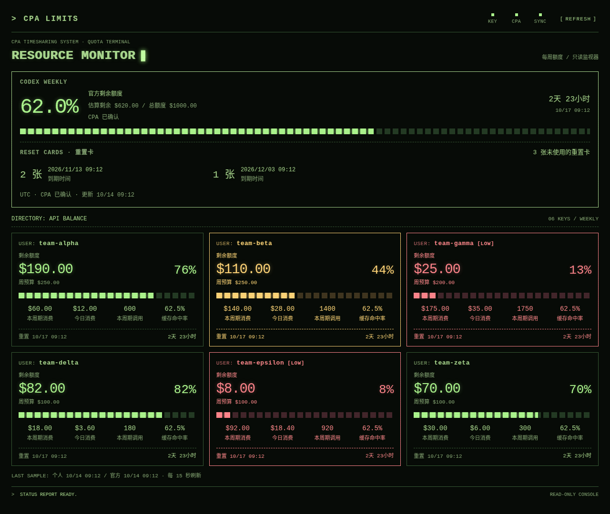
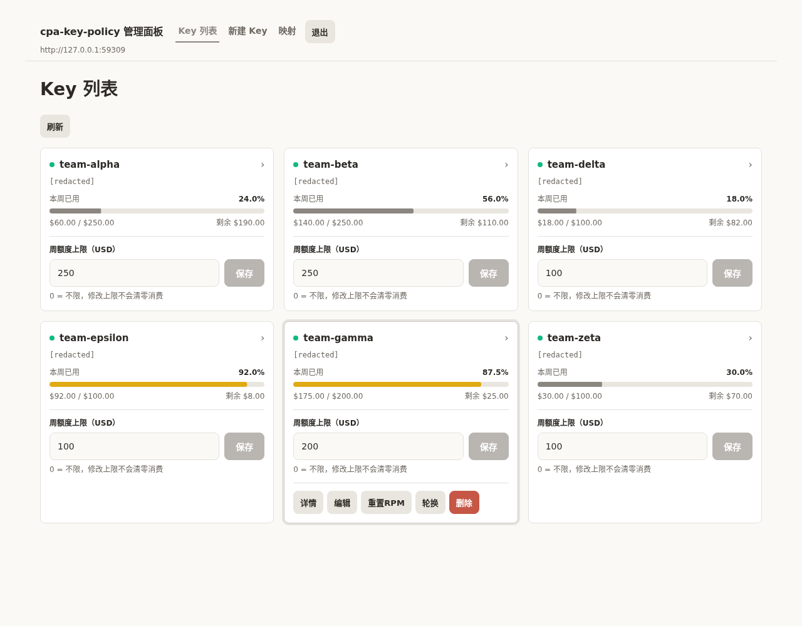

# cpa-key-policy

[CLIProxyAPI](https://github.com/router-for-me/CLIProxyAPI) 的 API Key 管理插件，支持模型权限、请求限速、每日与每周预算，以及模型别名和凭证分组。可在 CPA 内管理 Key，也可部署独立的 CPA Limits 页面查看额度和用量。

版本：**0.5.1-community.2**（预发布） · [English](README.md)

## 功能

- 为每个 Key 设置可用模型、RPM 和每日／每周预算。
- 按 token 或请求次数计费，默认显示周用量，支持在 Key 卡片中修改周预算。
- 为模型设置别名，并配置多个目标、优先调度或轮询。
- 按账户档位或自定义规则选择凭证，支持加权轮询。
- 通过网页或管理 API 创建、编辑、轮换和删除 Key。
- 通过可选的监控服务查看官方剩余额度、重置时间和各 Key 用量，并按需启用官方周期同步。

## 界面

CPA Limits 额度监控：



CPA 内的 Key 管理：



## 安装插件

提供的二进制适用于 **Linux amd64 / glibc**，已在 CPA **8.0.24** 验证。Alpine/musl、arm64 及其他环境需要单独编译和验证。

1. 从 [Releases](https://github.com/wenrui0128/cpa-key-policy-community/releases) 下载 Linux amd64 ZIP，并用 `SHA256SUMS` 校验文件。
2. 将 `cpa-key-policy-v0.5.1-community.2.so` 放入 CPA 的 `plugins.dir`。保留此文件名，CPA 会根据文件名识别插件 ID。
3. 在 CPA 配置中启用插件：

```yaml
plugins:
  enabled: true
  dir: "plugins"
  configs:
    cpa-key-policy:
      enabled: true
      priority: 10
      state_file: "cpa-key-policy-state.json"
      global_weighted_round_robin: false
```

4. 重启 CPA，打开管理页面：

```text
http://<CPA主机>:<端口>/v0/resource/plugins/cpa-key-policy/index.html
```

使用 CPA 管理密钥登录。页面将密钥保存在内存中，刷新后需要重新登录。通过公网访问时使用 HTTPS；管理入口也可放在加密的私有网络中。

升级时，先备份 `state_file`，替换动态库后重启 CPA。插件目录中只保留一份 key-policy 动态库，并沿用原来的 `state_file`，其中保存了 Key、别名、分组规则和用量。

完整配置示例见 [config.example.yaml](config.example.yaml)。

## 创建和使用 Key

1. 打开插件的 Keys 页面，创建 Key，选择允许使用的模型或别名。
2. 设置 RPM、每日／每周预算，以及模型的 token 单价或按次价格。
3. 保存创建时返回的完整 Key；创建或轮换后仅显示一次。
4. 在客户端填写 CPA 的 OpenAI 兼容接口地址，使用该 Key，并将 `model` 设置为允许的模型名或别名。

例如，为 `fast` 别名配置 `codex` 提供商和 `gpt-5.4-mini` 目标模型，客户端即可使用 `model: fast` 发起请求。

**不要把插件创建的 Key 再添加到 CPA 原生 `api-keys` 中，否则可能绕过插件的权限和预算限制。**

### 预算和计费

- 消费按配置的模型价格折算为美元，分别受每日和每周预算限制。
- **预算为 0 表示不限额**。未定价或价格为 0 的模型可能不产生扣费。
- 预算检查依据已完成请求的消费，并发执行中的请求没有预留额度，最终消费可能超过上限。
- 默认界面显示周用量。每日统计在 UTC 00:00 切换。
- `/v1/models` 权限是允许或拒绝访问；允许后返回 CPA 全局模型列表，不按 Key 过滤。请求模型时仍会检查该 Key 的模型权限。

### 管理页面

| 页面 | 用途 |
|---|---|
| Keys | 管理 Key、模型权限、RPM 和预算，查看用量 |
| 映射 → 别名 | 配置共享别名、多个目标、调度方式和价格 |
| 映射 → 凭证归类 | 配置自定义分组规则，预览匹配结果 |
| 模型选择器 | 按提供商、账户档位和自定义分组选择模型 |

## 部署额度监控

[CPA Limits](monitor/README.md) 是独立的 Python 服务，用于查看官方周额度、重置时间、各 Key 预算和用量，以及重置卡有效期。监控页面只提供查看功能；预算和 Key 设置在插件管理页面修改。

默认关闭官方周期同步。设置 `SYNC_OFFICIAL_CYCLE=true` 后，全部插件 Key 可跟随一个 Codex 账户的官方周周期：首次同步保留已有消费，后续确认新周期后归档旧用量，并保留周期开始后已记录的消费。

`ESTIMATED_TOTAL` 仅用于显示总额度估算，不会修改 Key 预算。官方额度百分比与插件按价格累计的金额分别统计。

安装、登录、HTTPS 反向代理和参数说明见 [监控部署文档](monitor/README.md)。

## 模型别名和凭证分组

### 别名

别名将客户端模型名映射到一个或多个上游目标，Key 可以引用同一个别名。

| 字段 | 含义 |
|---|---|
| `provider` | CPA 提供商标识，例如 `codex`、`claude`，或 OpenAI 兼容通道的 `name` |
| `target_model` | 上游模型 ID |
| `group` | 可选的凭证组 |
| `dispatch` | `priority` 或 `round-robin` |
| `billing_mode` | `tokens`（按百万 token 定价）或 `per_call`（按次定价） |

同一请求的鉴权与路由使用同一次目标选择，确保凭证组与目标一致。非流式 JSON 响应中的顶层 `model` 会改回别名；流式响应正文保持原样。

OpenAI 兼容通道使用 CPA 配置中的通道 `name` 作为 `provider`。通道的 `models` 列表需包含目标模型，否则 CPA 可能返回无可用凭证的错误。

### 凭证组

| 类型 | `group` 写法 | 配置来源 |
|---|---|---|
| 内置账户档位 | `free`、`team`、`supported` 等 | Codex `plan_type`、Antigravity `tier` |
| 自定义分组 | `classify:组名` | 插件的凭证归类规则 |

自定义规则使用正则表达式匹配 `filename`、`provider`、`plan_type`、`tier` 等字段。同一凭证可以属于多个自定义组。没有匹配规则时，Codex 和 Antigravity 使用内置档位；其他 auth-file 提供商不分组。OpenAI 兼容及 API Key 通道不分组。

启用组过滤时，插件只选择组内凭证；没有可用凭证则返回 `auth_not_found`。

### 加权调度

插件先选择可用凭证中最高的 `Priority` 层，再按权重执行平滑加权轮询。

- 权重依次读取 `Weight`、`Attributes.weight` 和 `Metadata.weight`。
- 未配置或无法解析时按 `1` 处理；非正数暂停接收新请求；最大值为 `1000000`。
- 轮询状态按 `provider + model + group + Priority` 共享，因此所有插件 Key 使用同一分配比例。
- 只有高优先级凭证全部不可用或权重非正时，才使用低优先级凭证。
- CPA 未传递鉴权阶段的 group 元数据时，插件 Key 使用当前提供商和模型的全局加权轮询。CPA 原生 Key 不受影响。

设置 `global_weighted_round_robin: true` 会跳过组过滤，将当前提供商和模型的全部候选凭证放入同一个权重池。需要按账户档位隔离请求时，保持此选项为 `false`，并确认所用 CPA 版本能传递 group 元数据。

## 管理 API

接口前缀为 `/v0/management/plugins/cpa-key-policy`，使用 CPA 管理密钥进行 Bearer 鉴权。

| 接口 | 用途 |
|---|---|
| `GET/POST/PATCH/DELETE /keys` | 查询、创建、修改和删除 Key |
| `POST /keys/rotate?id=…` | 轮换 Key |
| `POST /keys/reset-rpm?id=…` | 重置 RPM 计数 |
| `GET /keys/usage?id=…` | 查询 Key 用量 |
| `GET /status` | 查询插件状态 |
| `GET/POST/DELETE /aliases` | 管理别名 |
| `GET/POST/DELETE /classify-rules` | 管理凭证归类规则 |
| `POST /classify-rules/reorder` | 调整规则顺序 |
| `POST /classify-preview` | 预览分组匹配结果 |
| `POST /catalog` | 生成模型选择器目录 |

设置 `CPA` 为 CPA 基础地址、`MANAGEMENT_KEY` 为管理密钥后，可创建 Key：

```bash
curl -X POST "$CPA/v0/management/plugins/cpa-key-policy/keys" \
  -H "Authorization: Bearer $MANAGEMENT_KEY" \
  -H "Content-Type: application/json" \
  -d '{
    "id": "team-a",
    "name": "Team A",
    "rpm": 60,
    "models": [
      {"alias":"fast","provider":"codex","target_model":"gpt-5.4-mini","group":"free"}
    ]
  }'
```

响应中的 `plain_key` 仅返回一次，请及时保存。

## 从源码构建

需要 Node.js 24+、Go 1.27.2，以及支持 cgo 的 C 编译器。在 Linux amd64 上运行：

```bash
make test
make build-linux-amd64
```

安装时重命名构建输出：

```bash
install -m 0644 dist/cpa-key-policy_linux_amd64.so \
  "$CPA_PLUGIN_DIR/cpa-key-policy-v0.5.1-community.2.so"
```

`CPA_PLUGIN_DIR` 指向 CPA 的插件目录。在原生 Linux arm64 环境中可使用 `make build-linux-arm64`；该平台尚未完成运行验证。Windows 可通过 WSL/Linux 构建。

开发前端：

```bash
cd web
npm ci --ignore-scripts
VITE_CPA_BASE=http://127.0.0.1:8317 npm run dev
```

单独编译 Go 动态库前，先运行 `make web-build`，将前端嵌入文件更新到插件中。

## 测试

在仓库根目录运行：

```bash
go test ./...
(cd web && npm test && npm run build)
python3 -m unittest discover -s monitor -p 'test_*.py' -v
```

集成测试使用 Linux Docker 主机和本地 CPA 8.0.24 镜像：

```bash
python3 scripts/test-integration.py
```

可通过 `CPA_TEST_IMAGE` 指定镜像。测试使用临时容器、独立网络和模拟的官方额度响应，结束后清理测试状态。兼容性和测试范围见 [VALIDATION.md](VALIDATION.md)，安全配置见 [SECURITY.md](SECURITY.md)。

## 项目来源与许可证

基于 [origin652/cpa-plugin-key-policy](https://github.com/origin652/cpa-plugin-key-policy) v0.5.1 开发，沿用 [MIT 许可证](LICENSE) 并保留原作者署名。此仓库为社区分支；[CPA 插件商店](https://github.com/router-for-me/CLIProxyAPI-Plugins-Store) 提供的是上游版本。

版本变更见 [CHANGELOG.md](CHANGELOG.md)。
